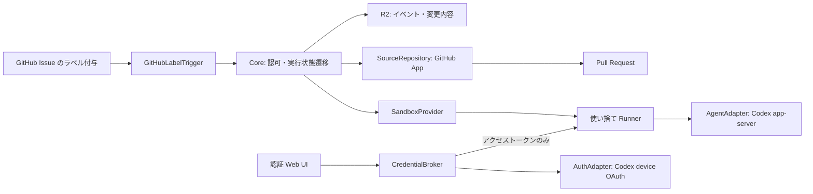

# Meguri

Issue にラベルを付けると、Cloudflare の Sandbox で Codex が実装し、GitHub App が PR を作成するプロトタイプです。複数の公開リポジトリを設定できます。

MVP の終点は **PR 作成**です。CI 修正ループ、自動レビュー、自動マージ、汎用の管理画面は含みません。Web UI は ChatGPT の接続・再接続・切断に絞っています。

隔離実行の基盤は **Cloudflare Containers** です。Durable Object の `ctx.container` API で起動・停止し、コンテナ内の Node.js Runner に HTTP でジョブを渡します。`@cloudflare/sandbox` SDK 1.0 が追加する `Files`、`S3Mount`、`DirectoryBackup` は現在使用しないため、SDK と `sandbox-shim` は組み込んでいません。必要になった時点で Sandbox Adapter 内に導入できます。[SDK 1.0 の役割](https://developers.cloudflare.com/changelog/post/2026-09-30-sandbox-sdk-1-0/)

## 構成と境界



| 場所 | 責務 |
| --- | --- |
| `src/contracts` | 制御側と Runner が共有するシリアライズ可能な契約 |
| `src/core` | プロジェクト・起動者の認可、実行の状態遷移、外部機能の Port |
| `src/adapters/triggers` | 署名検証、ラベルと installation の確認、共通実行要求への変換 |
| `src/adapters/auth` | プロバイダ固有の認証・更新。保存の責務を持たない |
| `src/adapters/agents` | Agent の起動、入力、セッション ID、イベント、認証更新要求の変換 |
| `src/adapters/git` | Issue と基準コミットの取得、変更の公開、PR 作成 |
| `src/adapters/sandbox` | Sandbox の起動・状態取得・停止 |
| `src/cloudflare` | Workers の HTTP 経路、Durable Objects による永続化・排他・スケジューリング、R2 |
| `src/runtime` | コンテナ内のジョブ管理、Git 作業ディレクトリ、セットアップ、検証、変更抽出 |

Core と共有契約は Cloudflare SDK、Node.js、Codex、OAuth クライアントを import しません。Runner は長期の認証情報や GitHub App 実装を import しません。`npm run check:boundaries` がこの依存方向を検証します。

別の Agent は `AgentAdapter` と Runner の登録を追加します。モデルを変えるだけならプロジェクトの `model` で指定できます。別の起動経路は `TriggerAdapter` から同じ `ExecutionRequest` を返すように追加します。ラベルや GitHub の Webhook オブジェクトを Core へ持ち込みません。認証の契約には device と redirect の両方の challenge を用意してありますが、MVP の具体的な実装は Codex device OAuth だけです。MCP・外部コネクタの認証、他プロバイダ、セッション再開は後続実装です。

## 実行と認証の動作

1. 署名済みの `issues.labeled` Webhook を受信します。設定されたラベル、installation、許可された起動者を確認します。
2. ControlPlane が delivery ID の重複を排除し、同一 Issue の同時実行を防ぎます。全体の同時実行は最大4件です。永続的な outbox と Durable Object の alarm で実行を起動します。
3. GitHub App が公開 Issue と base commit を取得します。Runner は認証なしで対象リポジトリを clone します。
4. Codex が実装し、設定された検証コマンドを実行します。Agent がコミットした変更も含め、base commit との差分を抽出します。
5. 制御側の GitHub App がファイル・tree・commit・branch・PR を作成します。**GitHub のトークンや秘密鍵は Sandbox に渡しません。** PR 作成の通信結果が失われても、同じブランチの PR を確認して復旧します。
6. 実行終了時に Sandbox を破棄し、Issue のロックを解放します。変更がなければ `no_changes`、検証失敗は `failed` で終了します。

ChatGPT 接続は、Web 画面のボタンから開始します。表示されたコードをコピーして OpenAI の認証画面へ進み、ログインしてコードを入力すると、Meguri が完了を検知します。ローカルヘルパーは不要です。アカウントによっては ChatGPT のセキュリティ設定で device code login を有効にする必要があります。

CredentialBroker が接続ごとのアクセストークン・refresh token を AES-256-GCM で暗号化して保持します。暗号鍵は Worker Secret に保存します。更新処理は1つの Durable Object で直列化し、ローテーション後の組を保存してからアクセストークンを返します。Sandbox へ渡すのはアクセストークンと、実行時間・接続バージョンに紐づいた更新用 lease だけです。lease は認証用エンドポイントだけに使え、実行終了・切断・接続の置き換えで更新できなくなります。モデル通信のプロキシは実装していません。

接続の切断は Meguri 内の認証情報を削除します。既に渡したアクセストークンは OpenAI 側の有効期限まで利用できる可能性があります。実行中のジョブも止める場合は cancel API を使用してください。上流アカウントのセッション失効とは別の操作です。

Codex は `0.166.0` に固定しています。認証アダプターの device endpoint は Codex の実装に合わせた互換コードで、汎用的な SIWC の本人確認ログインとは分けています。Sandbox 側の外部トークンモードは実験的 API です。更新時にはプロトコルの検証も行ってください。

## ローカル開発

Node.js 22.22 以上、npm、実行中の Docker が必要です。

```sh
npm ci
cp .dev.vars.example .dev.vars
```

`.dev.vars` を実際の設定に置き換えます。ランダム値の生成例は `openssl rand -hex 32`、暗号鍵だけは `openssl rand -base64 32` です。`MEGURI_GH_APP_PRIVATE_KEY` は GitHub App が発行する PEM 全体です。複数行の PEM は `.dev.vars` 内で `\n` を使用できます。

プロジェクトは `config/projects.example.json` を元に作成します。ローカルでは `wrangler.jsonc` の `vars.PROJECTS` に JSON 文字列を設定してください。`APP_ORIGIN` の既定値は `http://localhost:8787` です。同じ URL で画面を開いてください。Origin が違う変更要求は拒否します。

```sh
npm run dev
```

画面で管理用パスワードを入力し、ChatGPT を接続します。GitHub Webhook の実地検証には、ローカル Worker に到達する HTTPS の転送先を用意するか、GitHub Actions でデプロイした環境を使います。

### プロジェクト設定

`config/projects.example.json` が形式の例です。

- `id`: 一意なプロジェクト識別子。
- `repository`: 公開リポジトリの `owner/name`。同じリポジトリの重複登録は拒否します。
- `installationId`: GitHub App のインストール設定 URL の末尾にある数値。取得手順は下の「GitHub App」を参照してください。
- `triggerLabel`: 起動するラベル。例は `meguri:run`。
- `allowedActors`: ラベルを付けて起動できる GitHub ログイン名。空にはできません。
- `engine` / `connectionId`: MVP は `codex` / `default`。1つの ChatGPT 接続を複数プロジェクトで共有します。
- `model`: 任意。省略時は Codex の既定値を使用します。
- `baseBranch`: 任意。省略時はリポジトリの既定ブランチ。
- `maxRunMinutes`: 1〜60分、既定30分。セットアップと検証も含みます。
- `setupCommands` / `testCommands`: 信頼する管理者が設定する Bash コマンド。例は `npm ci` と `npm test`。検証コマンドが失敗した変更は公開しません。

対象プロジェクトに必要なシステムパッケージは Dockerfile に追加してください。初期イメージには Node.js、npm、Git、Bash、Python、make、g++、ripgrep を含めています。

## GitHub App

専用の GitHub App を作成し、対象リポジトリにインストールします。

- Repository permissions: **Contents: Read and write**、**Issues: Read-only**、**Pull requests: Read and write**、Metadata は既定の Read-only。
- Webhook URL: `https://meguri.suzuki3.jp/webhooks/github`。
- Webhook secret: `MEGURI_GH_WEBHOOK_SECRET` と同じ値。
- Subscribe to events: **Issues**。

`installationId` は App ID とは別の値で、インストール設定の URL から取得します。個人アカウントの場合は次の手順です。

1. [インストール済み GitHub Apps](https://github.com/settings/installations) を開き、作成した App の **Configure** を押します。
2. URL が `https://github.com/settings/installations/12345678` なら、`12345678` が installation ID です。`MEGURI_PROJECTS` 内に `"installationId": 12345678` と数値で指定します。
3. App が一覧にない場合は、Developer settings → GitHub Apps → 対象 App の Edit → Install App から、対象アカウントとリポジトリを選んでインストールします。

Organization にインストールした場合は、その Organization の Settings → GitHub Apps → 対象 App の Configure を開き、`https://github.com/organizations/ORG/settings/installations/12345678` の末尾の数値を使用します。同じ App を同じアカウントへインストールして複数リポジトリを許可した場合、各プロジェクトの installation ID は共通です。

実行トークンは installation 単位からさらに対象の1リポジトリに絞って発行します。PR とコミットは GitHub App によって作成されます。個人 PAT は使用しません。`.github/workflows` の変更は、GitHub App 側で追加の権限が必要になる場合があります。

## GitHub Actions からの Cloudflare デプロイ

**Cloudflare の GitHub Integration / Workers Builds は使用しません。** `.github/workflows/deploy.yml` が `main` の push または手動起動で Wrangler を実行し、Worker・Durable Object・Sandbox image・Worker Secrets をまとめてデプロイします。Cloudflare にソースリポジトリを接続する設定は不要です。

Cloudflare アカウントでは Workers Paid、Containers、R2 を利用できる状態にします。API token は対象アカウントに絞り、Worker の初回作成ができる Workers Admin、Containers とイメージのアップロードに必要な Workers Containers Write、bucket の初回作成用に Workers R2 Storage Write を設定します。カスタムドメインを構成するため、**Zone → Workers Routes → Write（画面によって Edit）と、Wrangler のゾーン探索用に Zone → Zone → Read を `suzuki3.jp` ゾーンに追加**します。Cloudflare の [権限の説明](https://developers.cloudflare.com/workers/authorization/workers/)、[ゾーン取得 API](https://developers.cloudflare.com/api/resources/zones/methods/list/)、[Containers デプロイ手順](https://developers.cloudflare.com/containers/guides/deploy/) を参照してください。

GitHub の `production` Environment に以下を登録します。Environment の代わりに同名の Repository Secrets / Variables を使用することもできます。

| 種類 | 名前 | 内容 |
| --- | --- | --- |
| Secret | `CLOUDFLARE_API_TOKEN` | デプロイ用 API token |
| Variable | `CLOUDFLARE_ACCOUNT_ID` | Cloudflare アカウント ID |
| Variable | `MEGURI_APP_ORIGIN` | `https://meguri.suzuki3.jp` |
| Variable | `MEGURI_PROJECTS` | プロジェクト設定の JSON 配列 |
| Variable | `MEGURI_GH_APP_ID` | GitHub App ID |
| Secret | `MEGURI_GH_APP_PRIVATE_KEY` | GitHub App の PEM 全体 |
| Secret | `MEGURI_GH_WEBHOOK_SECRET` | Webhook の共有 secret |
| Secret | `ADMIN_PASSWORD` | 16文字以上の管理用パスワード |
| Secret | `SESSION_SECRET` | 32文字以上のセッション署名用ランダム値 |
| Secret | `CREDENTIAL_ENCRYPTION_KEY` | base64 形式の32バイトの暗号鍵 |
| Variable、任意 | `MEGURI_WORKER_NAME` | 既定 `meguri` |
| Variable、任意 | `MEGURI_BUCKET_NAME` | 既定 `meguri-artifacts` |

GitHub Actions の Secrets と Variables は `GITHUB_` で始まる名前を登録できないため、GitHub App 関連の設定は `MEGURI_GH_` で統一しています。GitHub App の鍵は、アプリの設定画面で Credentials → Key pairs → New key から発行します。

`MEGURI_PROJECTS` を省略する場合は、実際の設定を `config/projects.json` にコミットします。ここには秘密情報を入れません。設定が空ならデプロイを止めます。

公開 URL は **`https://meguri.suzuki3.jp`** です。`wrangler.jsonc` の Custom Domain として設定し、`workers.dev` での公開は無効にしています。`suzuki3.jp` がデプロイ先の Cloudflare アカウントで有効なゾーンになっていることが前提です。デプロイ時に Cloudflare が DNS レコードと証明書を構成するので、事前に CNAME を作る必要はありません。同じホスト名の既存レコードがある場合は競合を確認してください。初回の DNS・証明書の準備を待てるよう、デプロイ後の疎通確認は最大約4分再試行します。詳細は [Custom Domains](https://developers.cloudflare.com/workers/configuration/routing/custom-domains/) を参照してください。

`MEGURI_APP_ORIGIN` と Custom Domain が異なる場合はデプロイ設定の検証で停止します。ドメインを変える際は両方を更新してください。ローカル開発は `http://localhost:8787` のままです。

ワークフローは設定を検証し、未作成なら R2 bucket を作成してからデプロイします。秘密情報は runner の一時ファイルへ書き、`wrangler deploy --secrets-file` に渡して終了時に削除します。ログや成果物へアップロードしません。PR の CI は actionlint による GitHub Actions の構文・式の検証、テスト、Worker の dry-run、Docker image のビルドまでで、デプロイ用 Secrets を使用しません。

デプロイ後は Web 画面で ChatGPT を接続し、対象 Issue に設定したラベルを付けます。

## ログと検証

`npm run check` で依存境界、型、ユニット・結合テスト、Runner のバンドルを確認します。テストには実際の固定版 Codex app-server との初期接続も含めますが、既存の認証情報は読み込まず、モデルの推論は実行しません。

Cloudflare Workers Logs には実行状態・エラー・認証更新の診断を記録します。R2 の `runs/<runId>/logs/*.ndjson` に Agent のイベントとコマンド出力、`result.json` に要約と変更内容、失敗時は `failure.json` を保存します。管理者のセッションで以下の API を利用できます。

| API | 内容 |
| --- | --- |
| `GET /api/runs` | 最近50件の実行 |
| `GET /api/runs/<id>` | 実行状態、PR URL、直近のイベント |
| `GET /api/runs/<id>/logs` | ログ part の取得先一覧 |
| `GET /api/runs/<id>/logs?part=00000001` | 指定 part の NDJSON |
| `POST /api/runs/<id>/cancel` | 実行を中止し Sandbox を破棄。ブラウザと同じ Origin が必要 |

既知のトークン値・credential フィールド・JWT・GitHub token をログでマスクします。Langfuse は未接続です。R2 の保存期間は自動設定していないため、必要に応じて bucket の lifecycle rule を設定してください。

## プロトタイプの範囲

- 個人利用、公開の対象リポジトリ、ChatGPT 接続は1つです。複数プロジェクトに対応しますが、マルチテナントではありません。
- 1実行最大100ファイル、1ファイル1MB、変更全体7MB。削除・rename・実行権限・symlink・binary に対応し、submodule の変更は失敗として扱います。
- ログは最大2万イベント・約20MBで打ち切り、打ち切りイベントを記録します。各イベント本文も制限します。
- Sandbox が消失した場合は失敗にし、Agent を自動で最初から再実行しません。セッションファイル・作業ディレクトリの永続化や再開はありません。
- Sandbox 内のコードは渡されたアクセストークンを読み取れます。プロキシ、外向き通信の制限、プロジェクトの追加 Secrets、MCP・コネクタの接続管理は後続タスクです。ログのマスクは任意の符号化や意図的な持ち出しを防ぐ境界ではありません。
- refresh token 更新成功直後の永続化前にプロセスが失われると、再接続が必要になる可能性があります。暗号鍵を失った場合も再接続が必要です。
- PR 作成後の CI・レビュー・マージは人間が担当します。

実装の参照元: [Codex app-server](https://learn.chatgpt.com/docs/app-server)、[Codex device login](https://github.com/openai/codex/blob/021fccb046508938c4754982efccfb51d6e8356e/codex-rs/login/src/device_code_auth.rs)、[Cloudflare Container API](https://developers.cloudflare.com/containers/api/durable-object-container/)、[GitHub Actions からのデプロイ](https://developers.cloudflare.com/workers/ci-cd/external-cicd/github-actions/)。
