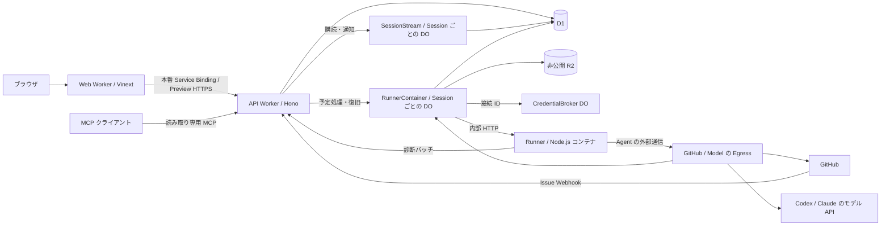

# Tailos のアーキテクチャ

GitHub の Issue イベントと Web のメッセージを、利用者が後から続けられる Session と、一回分の実行を表す Run に結び付ける。Project がリポジトリと実行条件を、Routine が起動条件とプロンプトを持つ。Runner は Codex と Claude Code を実行する。ユーザー向けの状態と実行結果は API が所有し、Runner と切り離して Web と MCP から読める。現行の実行・継続・公開の決定は [実行モデル](../pdr/records/PDR-20261123-execution-model.md)、[Session の継続](../pdr/records/PDR-20261128-session-continuity-branches.md)、[Git による公開](../pdr/records/PDR-20261128-agent-git-publication.md) にある。

- [内部依存関係のベースライン](dependencies.md)
- [改善の記録とタスクプール](progress.md)

## 実行時の構成

1. `bootstrap/http.ts` が API のユースケース、認証、D1・Cloudflare・GitHub の実装を組み立てる。GitHub の署名検証の後、Issue イベントを Project と Routine に照合する。Web からの開始・追送と Issue からの受付は、別々の入力条件を持つ。
2. D1 が受付と重複防止、Session と Run の関連、Run の進行を保存する。RunnerContainer が Session 単位でアラームを使い、`advanceRun` が選んだ次の処理を行う。Worker の Cron は D1 を照合し、処理待ちの Run、Inbox、Issue 通知、タイムライン通知、期限切れの記録を扱う。
3. Runner の内部 HTTP サーバーが共有ジョブスキーマを検証し、Adapter がプロバイダー固有の会話と応答を扱う。Runner の作業領域は Session の再開に必要な情報を R2 に保存する。DO のコンテナスナップショットは復元を速める。
4. 診断イベントから表示用のタイムラインを API で投影する。HTTP でスナップショットと履歴を読み、SessionStream がコミット済みの更新を WebSocket で配信する。MCP は所有者の Session、Run、診断などを照会する。

## モジュールの責務と公開境界

| モジュール | 責務と利用する入口 |
| --- | --- |
| [Web](../../apps/web/src) | `app` が Vinext のルート・レイアウト・Provider を組み立てる。`_pages` が Home、Session 詳細、Routine、Project 設定、Account、Connect、MCP キー、診断画面を所有する。再利用する UI は `widgets`、ユーザー操作は `features`、業務概念の読み取り・表示は `entities`、汎用 UI・通信・公開設定は `shared`。slice の入口は `index.ts` と必要に応じて `index.server.ts`。Worker は CSP と API 転送を担う。 |
| [API の composition](../../apps/api/src/bootstrap) | `worker.ts` と `bootstrap` がアダプターを組み立てる。本番ブラウザ API は `/api/v1`、ローカルの直通 API は `/v1`。公開型は `@tailos/api/browser` の `BrowserApi`。MCP は `/mcp`、GitHub からは `/webhooks/github`。内部経路の入口と認証は `bootstrap/http.ts` を参照する。 |
| [API の application](../../apps/api/src/application) | Project 設定、Routine 設定・Issue dispatch、Session 開始・継続・一覧、Run の進行・復旧、認証、通知、診断・照会・タイムライン。ユースケース関数と必要な依存の型を公開する。 |
| [API の infrastructure](../../apps/api/src/infrastructure) | D1 のクエリ・トランザクション、R2、GitHub、Better Auth、プロバイダー接続、DO の実装を所有する。presentation が直接呼ぶ実装の組み立ては composition に置く。 |
| [Runner](../../apps/runner/src) | `index.ts` から内部 HTTP の `server.ts` を起動する。共通実行手順、Git 作業ツリー、継続データと診断配送を担当する。`AgentAdapter` の Codex app-server と Claude Agent SDK 実装は、それぞれの SDK・プロトコルを扱う。 |
| [Core](../../packages/core/package.json) | `auth` が認証と公開経路の定数、`models` が Provider とモデル・effort のカタログ、`runner` が Job・Run 結果・継続情報、`diagnostics` が診断、`timeline` が配信契約を所有する。公開入口は package exports。 |
| [Diagnostics](../../packages/diagnostics/package.json) | Runner と API が使う Secretlint ベースの本文検査・マスキング。共有する入口は `@tailos/diagnostics`。 |
| [運用・検証ツール](../../tools) | Preview の構築・公開・セットアップ・撤去、PDR の検索と検証。API の provision・deploy・seed は `apps/api/scripts`、リポジトリ固有の境界検査は `lint`。 |

## 状態の所有権

| 状態・ルール | 正本 | 読み取り・派生状態 |
| --- | --- | --- |
| 利用者、ログイン、MCP キー | D1 の認証テーブルと MCP キーテーブル。ポリシーは API の auth と presentation middleware | ブラウザはホスト限定 Cookie とプロフィール。MCP は別の読み取り用キー |
| Codex・Claude 接続 | `CredentialBroker` の暗号化ストレージ。更新の排他と接続失効もここで管理 | Web の接続状態、Runner の実行中だけ有効な置き換え用資格情報 |
| Project・Routine と変更履歴 | D1 の Project / Routine、変更履歴。設定値は application のスキーマが検証 | API の一覧・管理と Web の query cache |
| 起動、重複排除、Issue の継続先 | D1 の `trigger_events`、`routine_sessions`、`session_inbox`、`issue_guidance`。受付判断は application | GitHub 配送・通知と Web の Routine 別 Session 一覧 |
| Session、メッセージ、Run、公開結果 | D1 の `sessions`、`session_messages`、`runs`。公開状態そのものは GitHub | Web の SSR・query cache、MCP の読み取り、Run 固有の結果参照 |
| コンテナ進行、実行リース、継続 | RunnerContainer のストレージが進行・リース・復元情報を所有。Runner は実行中の Job と作業ツリー、R2 は継続用データを所有 | DO のスナップショットは再開を速めるキャッシュ |
| 診断とタイムライン | D1 の診断と activity テーブル、R2 の本文。通知待ち記録を保存と同時に書く | SessionStream の接続とカーソル、Web のタイムライン cache。保存・保持の範囲は [Diagnostics](../diagnostics.md) |
| UI の選択、入力、表示 | Project 選択はページシェルに渡す Client Provider。フォームや表示の状態は該当 slice | TanStack Query は API データの複製。SSR の cache はリクエスト単位 |
| UI の見た目と部品 | [デザインシステム](../design-system/README.md) の所有範囲、Web Shared の tokens と primitives | 新しい共通シェルと互換用の管理画面は [採択済みの適用範囲](../pdr/records/PDR-20261128-web-design-compatibility.md) を使う |
| デプロイ設定・判断 | Worker の wiring は Wrangler 設定と deploy scripts、プロダクト判断は PDR の採択済みレコード | Preview 設定はビルド時に生成、PDR の SQLite は再生成可能な検索索引 |

## 技術と検証

| 対象 | 方式 |
| --- | --- |
| UI と取得 | Vinext、React Server Components、React Aria、Tailwind CSS、TanStack Query、Hono Client。旧管理画面にも利用中のルートがある。 |
| API と保存 | Hono、Valibot、Drizzle、D1 のバッチと SQL、R2、Cloudflare Durable Objects、Better Auth。Drizzle schema は開発時の定義で、適用される DDL の履歴は migrations。 |
| Agent と通信 | Node.js 22、esbuild、Docker、Codex app-server、Claude Agent SDK。Runner との内部 HTTP、タイムラインの WebSocket、外部向け JSON API と MCP は用途別の境界。 |
| ローカルと CI | pnpm workspace、TypeScript project references、Vitest、Miniflare、Node test、Oxlint、Steiger、Oxfmt。実行順とコマンドは [CI](../../.github/workflows/ci.yml) に従う。 |
| デプロイ | [本番](../deploy.md)と [PR Preview](../pr-previews.md)は別の Worker とデータを使う。Preview 同士で D1・R2 を共有するため、先行 migration の適用と公開済みコードの互換性が必要。Preview の確認範囲は Web・HTTP API・GitHub ログインで、Runner・Webhook・Cron の実行確認は本番相当の別経路が必要。 |
| 規範の自動検査 | Oxlint が [API のレイヤー](../../lint/api-layers.mjs)と [Web の接続境界](../../lint/web-boundaries.mjs)を、Steiger が Web の slice を検査する。導入済み構成での禁止・許可例を lint テストが確認する。 |
