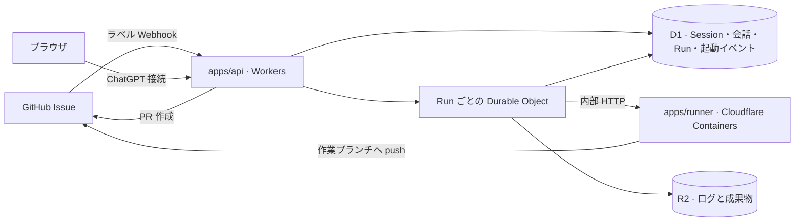
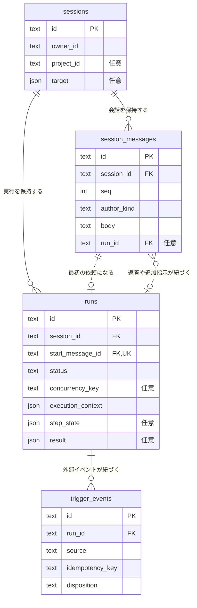

# Meguri 本実装の設計

## MVP の範囲

GitHub Issue に `meguri:run` ラベルを付けると、Meguri が Session と最初の依頼を作る。Cloudflare のコンテナで Codex を実行し、作業ブランチにコミットして PR を作る。依頼と Agent の返答は Session の会話履歴に、PR はその Run の結果に保存する。Public / Private リポジトリを対象にし、プロジェクトの設定は config で管理する。PR 作成後のレビューとマージは人が行う。

ChatGPT の接続画面は Hono JSX で API に同居させ、ブラウザから接続を完了できるようにする。Web チャットからの起動・続行、実行中の追加指示、未公開の作業の復元、CI 結果による自動修正、レビューループ、他の Agent、MCP・コネクタ、モデル通信のプロキシは後続とする。

`prototype` ブランチは実行経路や外部 API との接続の参考にする。本実装では会話と実行状態を D1 に集約する。

## 構成と依存の境界

| 配置 | 技術 | 責務 |
| --- | --- | --- |
| `apps/api` | Hono、Hono JSX、Cloudflare Workers、Wrangler、Drizzle ORM | トリガーの受付、Session と会話履歴の管理、Run の進行、コンテナ制御、プロバイダ認証、PR 作成 |
| `apps/runner` | Node.js 22、`node:http`、esbuild、Docker | 内部 HTTP でジョブを受け取り、作業ディレクトリ内で Agent を実行する。MVP の実装は Codex app-server |
| `packages/core` | TypeScript、Valibot | ジョブ、イベント、結果など API と Runner の共有契約 |

- **起動の境界。** GitHub の署名検証、起動者と対象の確認、ラベルの判定は API のトリガー実装が担当し、Session に入れる依頼へ変換する。自動で PR を公開できるかなどの権限は API が確定する。将来は Web や API からの依頼も同じ実行経路に載せられる。
- **実行の境界。** Runner 内に `AgentAdapter` を置き、Codex 固有の起動・入力・イベント・結果の変換をその実装に閉じる。API と Runner は共通のジョブと結果の形式で通信する。
- **認証の境界。** プロバイダ固有の接続とトークン更新は API 側が担当する。共有契約は Cloudflare や Agent 固有の SDK に依存させない。実装は各 app の中に置き、共有する契約を `packages/core` に置く。

## Session と実行のデータモデル

**Session は、ユーザーが開くチャットの単位。Run は、その Session で受理した依頼を結果まで処理する一回分。** Issue にラベルを付けると、「この Issue を実装して PR を作る」という自動化メッセージが最初の Run を起動する。PR 作成で Run は完了し、Session には会話と各 Run の結果が残る。Codex の Thread など、Agent 固有の会話状態は Adapter が扱う。

| テーブル | 保存する情報 |
| --- | --- |
| `sessions` | 所有者は Meguri 上の ID で識別する。`project_id` は config の安定した ID を参照する。Project と作業対象は独立して任意とし、Issue 起動の `target` には GitHub リポジトリ ID と Issue 番号を入れる |
| `session_messages` | 自動化が生成した依頼、ユーザーの発言、Agent の確定した返答を `(session_id, seq)` の順に保存する。起点は `runs.start_message_id` で参照し、返答や将来の追加指示はメッセージの `run_id` で関連づける |
| `runs` | `queued`、`running`、`succeeded`、`failed` の状態、締切、次の処理時刻、失敗理由を持つ。`execution_context` は実行に使う Agent・接続 ID・基準コミット・自動公開の可否を記録する。`step_state` は作業ブランチ、公開処理の進行、ログの取得位置などを持つ。`result` には PR URL、公開したブランチとコミット SHA、`no_changes` などを記録する |
| `trigger_events` | 外部イベントの起動元、重複判定キー、受付時刻、対応する Run を記録する。`disposition` は起点の `started` と、既存 Run に合流した `coalesced` |

JSON の列はバージョン付きの Valibot スキーマで検証する。Issue 起動時は Issue の内容を最初の依頼に含め、基準コミットと実行設定を Agent 起動前に確定する。PR の参照は Run の結果に持たせるため、同じ Session で複数の PR を扱う場合も、どの依頼の結果かを追える。

受付時の整合性は D1 で守る。

1. Run と起点のメッセージ、メッセージと紐づく Run は、それぞれ複合外部キーで同じ Session 内に限定する。`start_message_id` を一意にし、一つの依頼から一つの Run を作る。各 Session の進行中の Run も一つに絞る。
2. `(source, idempotency_key)` を一意にする。同じ配送の再送では、完了後も記録済みの Run と Session を返す。
3. 進行中の Run だけ `concurrency_key` を一意にする。Issue → PR のキーは依頼の種類、GitHub リポジトリ ID、Issue 番号から作る。同じ Issue に対する別の配送が実行中に届いたら、`coalesced` として既存 Run に紐づける。完了後にラベルを付け直したら、新しい Session を作る。
4. 新規 Webhook の受付では Session、最初のメッセージ、Run、`started` イベントを一つの D1 バッチトランザクションで作る。外部イベントで始まる Run の `started` は一件に制限する。将来、Web から始まる Run はユーザーのメッセージを起点にする。

ラベルや対象リポジトリなどの起動ルールは config で管理する。Project の管理画面を作る段階で、既存の `project_id` を引き継ぎ、Project、リポジトリ、接続の割り当てを D1 に追加できる。単発チャットは Project やリポジトリを指定せずに作成できる。接続を使えるかどうかは実行時に確認する。

## 実行と復旧

D1 が Run の状態を持つ。MVP では DO が `runId` ごとに `ctx.container` でコンテナを起動・停止し、内部 HTTP で Runner と通信する。アラームで起きたら D1 の状態から次の処理を判断する。`next_action_at` を過ぎた Run を拾い直す経路を設け、D1 への書き込み直後に処理が落ちても復旧できるようにする。

状態遷移は更新前の状態を条件にして書き込む。コンテナ起動や GitHub への公開を再試行する際は、コンテナや作業ブランチ、PR の実態を確認する。たとえば PR の作成には成功し、D1 への URL 保存に失敗した場合は、確定済みの作業ブランチの PR を探して結果を記録する。

Run 完了時は、確定した Agent の返答と Run の結果を一緒に保存する。Run の進行と失敗理由は `sessionId` から対象の `runId` をたどって確認できるようにする。詳細な Agent イベント、コマンド出力、大きな成果物は R2 に保存する。認証情報は暗号化ストアと実行用の資格情報の経路で扱い、ログや成果物に含めない。

将来 Web チャットで続けるときは、同じ Session に新しいメッセージと Run を追加する。新しいコンテナに会話履歴と GitHub 上の作業結果を渡して再開する。MVP は、再開に使える情報として会話履歴と公開済みの GitHub 参照を記録する。未公開の差分や Agent 固有の再開用データを復元する機能は、後から Session にチェックポイントを紐づけて追加する。

## 認証と GitHub の権限

ChatGPT 接続は Hono JSX のボタンからデバイスコード認証を始める。ユーザーはブラウザでコードを入力し、Meguri が接続完了を検知する。長期の認証情報はクラウドの API 側で暗号化して保持し、接続単位で更新の競合を防ぐ。Runner には必要なアクセストークンと、Run に紐づく短命の更新用リースを渡す。リースは実行中の接続に対する更新に限定する。

GitHub では専用の権限主体として GitHub App を使う。App の秘密鍵は API 側に置く。Runner には対象リポジトリに限定した短命のインストールトークンを渡し、取得と作業ブランチへの push を許可する。既定ブランチへの直接 push やマージはブランチ保護で制限し、App にルールの迂回権限を与えない。

## ローカル開発とデプロイ

`pnpm dev` で Wrangler を起動し、その段階で使うリソースをローカルで動かす。D1 を導入した段階でローカルマイグレーションを加え、Runner を導入した段階でバンドルと Docker イメージのビルドを加える。Wrangler は Worker・DO・D1・R2 をローカルで動かし、Runner は実際の Docker コンテナで動かす。日常の開発ではテスト用の実行要求と固定応答の Agent Adapter を使う。

最小構成では、Wrangler `4.157.0` で Worker → DO → Docker の HTTP 疎通、ローカル R2 への読み書き、再起動後の DO ストレージの保持を確認済み。本実装で D1 を含む一連の動作はフェーズ 1 で検証する。 [Cloudflare Containers のローカル開発](https://developers.cloudflare.com/containers/guides/local-dev/)

D1 のスキーマとマイグレーションは `apps/api` に置く。Drizzle Kit で SQL を生成し、Wrangler でローカルと本番に適用する。デプロイは GitHub Actions が担当し、Cloudflare の GitHub Integration は使用しない。本番ドメインは `meguri.suzuki3.jp`。 [D1 のマイグレーション](https://developers.cloudflare.com/d1/reference/migrations/)

## 実装フェーズ

### フェーズ 1 のデプロイ単位

1A から順に積み上げる。各単位は、その時点の `main` を GitHub Actions から Cloudflare の検証環境へデプロイし、追加した動作を確認できるところまでで完了とする。検証用の操作は認証で保護する。1D 以降は、コンテナを制御する DO を持つ Worker と Runner イメージを同じリリースとして扱い、DO 経由の HTTP 疎通まで確認する。 [Cloudflare Containers のデプロイ](https://developers.cloudflare.com/containers/guides/deploy/)

| 単位 | デプロイする変更 | 完了条件 |
| --- | --- | --- |
| 1A. API の起動 | `apps/api` に Hono の `/health`、Wrangler 設定、検証環境へ手動デプロイする GitHub Actions ワークフローを追加する | ローカルの `pnpm dev` と Cloudflare の検証 URL の両方で `/health` が応答する |
| 1B. Session と会話履歴 | Drizzle で外部キーを含む D1 の4テーブルを一緒に作る。検証用に Session とメッセージの保存・照会を追加する | ローカルと検証環境で、Project やリポジトリを持たない Session にメッセージを保存し、順番に読み出せる |
| 1C. 起動イベントの受付 | テスト用イベントから Session、最初の依頼、Run、起点イベントを一括で作る | 同じ配送の再送では同じ Session と Run が返る。進行中の別配送は既存 Run に合流し、完了後の新しいイベントは新規 Session を作る |
| 1D. コンテナの疎通 | 最小の Node Runner、Dockerfile、コンテナを起動する DO を追加する。Runner の `/health` に内部 HTTP でアクセスする | ローカルの Docker と Cloudflare の両方で、Worker → DO → Runner の応答を確認できる。疎通確認後にコンテナを停止する |
| 1E. 固定ジョブの実行 | `packages/core` にジョブと結果の契約を置き、Runner に固定応答の Agent Adapter を追加する。Session の依頼から Run を実行する | Run が `queued` → `running` → `succeeded` と進み、同じ Session から返答と Run の結果を確認できる。締切を超えた場合は実行を終了し、失敗理由を確認できる |
| 1F. ログと成果物 | `runId` に紐づく Runner のイベント、ログ、成果物を R2 に保存する | Session から成功・失敗それぞれの Run をたどり、ログや保存した成果物を取得できる |
| 1G. 中断からの復旧 | DO のアラームと `next_action_at` を使った再試行・拾い直しを追加する | 起動要求や応答が途中で失われても、既存コンテナを確認し、同じ Run を続行するか失敗として確定できる |

### フェーズ 2 以降

| フェーズ | 作るもの | 完了条件 |
| --- | --- | --- |
| 2. ChatGPT 接続と Codex 実行 | Hono JSX の接続画面、認証情報の保管・更新、Codex app-server Adapter | ブラウザで ChatGPT に接続し、実際の Codex がテストジョブを完走する。Session の履歴に依頼と返答が残る |
| 3. GitHub Issue → PR | ラベル Webhook を起動イベントと最初の依頼に変換する。GitHub App で作業ブランチへの push と PR 作成を行う | Private リポジトリでラベル付与から PR 作成まで通り、Session の Run に PR が記録される。再送は元の Session、完了後のラベル付け直しは新しい Session になる |
| 4. 本番デプロイと運用確認 | フェーズ 1 から使ってきたデプロイワークフローを本番に適用する。D1 マイグレーション、Worker・Runner イメージのデプロイ、本番ドメインの設定を行う | `meguri.suzuki3.jp` で ChatGPT 接続から Issue → PR まで通り、`sessionId` から会話と Run の結果や失敗理由を追える |
