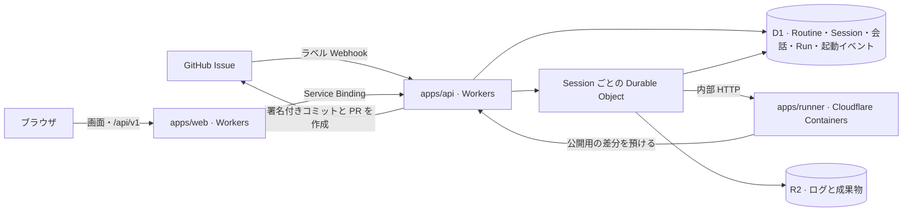
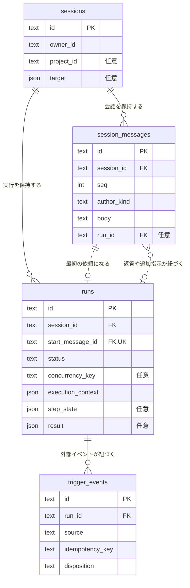

# Tailos 本実装の設計

## MVP の範囲

GitHub Issue に有効な Routine の起動ラベルを付けると、Tailos が設定されたプロンプトで Session と最初の依頼を作る。既存設定の移行では従来の `tailos:run` 等のラベルを引き継ぐ。Cloudflare のコンテナで Codex を実行し、作業ブランチにコミットして PR を作る。依頼と Agent の返答は Session の会話履歴に、PR はその Run の結果に保存する。Public / Private リポジトリを対象にし、プロジェクトの設定は D1 に保存し、運用者が Web の `/projects` で管理する。PR 作成後のレビューとマージは人が行う。

GitHub ログイン、ChatGPT 接続、Session 詳細は Web で提供する。ホームの入力欄からは、選択した Project で新しい Session と Run を開始できる（[判断](pdr/records/PDR-20261122-home-message-start.md)）。Session 画面の入力欄からは、作業中でない Session に続きのメッセージを送れる（[判断](pdr/records/PDR-20261124-session-message.md)）。実行中の追加指示、未公開の作業の復元、CI 結果による自動修正、レビューループ、他の Agent、MCP・コネクタ、モデル通信のプロキシは後続とする。

`prototype` ブランチは実行経路や外部 API との接続の参考にする。本実装では会話と実行状態を D1 に集約する。

[トリガーと実行設定の抽象化計画](plans/trigger-run-abstraction.md) に従い、トリガー条件・許可ユーザー・prompt・model・effort を束ねる `Routine` を D1 に保存し、label 起動から共通の Run 受付へ接続する。初回デプロイは Run のない状態を運用で作って行う。Routine は Model Provider として Codex と Claude を選べる（[判断](pdr/records/PDR-20261126-agent-selection-claude.md)）。PR イベント・cron は後続とする。

## 構成と依存の境界

| 配置 | 技術 | 責務 |
| --- | --- | --- |
| `apps/web` | vinext、React、Tailwind CSS、TanStack Query | ログイン、ChatGPT 接続、Project 設定、Session 詳細の画面 |
| `apps/api` | Hono、Cloudflare Workers、Wrangler、Drizzle ORM | トリガーの受付、Session と会話履歴の管理、Run の進行、コンテナ制御、プロバイダ認証、PR 作成 |
| `apps/runner` | Node.js 22、`node:http`、esbuild、Docker | 内部 HTTP でジョブを受け取り、作業ディレクトリ内で Agent を実行する。Codex は app-server、Claude は Agent SDK で実行する |
| `packages/core` | TypeScript、Valibot | ジョブ、イベント、結果など API と Runner の共有契約 |

API の HTTP ハンドラーとテストは `presentation/http/handlers/<機能名>/`、認証や Origin 検証のミドルウェアは `presentation/http/middlewares/`、ユースケースとその契約は `application`、D1・R2・外部 API の実装は `infrastructure` に置く。`bootstrap` と `worker.ts` が依存を組み立て、Oxlint がレイヤーをまたぐ import を検査する。

- **起動の境界。** GitHub の署名検証、起動者と対象の確認、ラベルの判定は API のトリガー実装が担当し、Session に入れる依頼へ変換する。自動で PR を公開できるかなどの権限は API が確定する。将来は Web や API からの依頼も同じ実行経路に載せられる。
- **実行の境界。** Runner 内に `AgentAdapter` を置き、Codex と Claude Code それぞれに固有の起動・入力・イベント・結果の変換をその実装に閉じる。API と Runner は共通のジョブと結果の形式で通信する。
- **認証の境界。** プロバイダ固有の接続とトークン更新は API 側が担当する。共有契約は Cloudflare や Agent 固有の SDK に依存させない。実装は各 app の中に置き、共有する契約を `packages/core` に置く。
- **Web の境界。** 本番のブラウザは `tailos.app/api/v1` の JSON API を Hono Client で呼ぶ。Web Worker は Service Binding を介して API Worker に転送し、SSR も同じ接続を使う。Web は公開ルートの型だけを `@tailos/api/browser` から取り込む。ログイン Cookie は `__Host-tailos.session_token` として発行し、`tailos.app` ホストに限定する。ログイン・ログアウトや更新リクエストでは Web の Origin を照合する。

## Session と実行のデータモデル

**Session は、ユーザーが開くチャットの単位。Run は、その Session で受理した依頼を結果まで処理する一回分。** Issue にラベルを付けると、一致した Routine のプロンプトによる自動化メッセージが最初の Run を起動する。PR 作成で Run は完了し、Session には会話と各 Run の結果が残る。Codex の Thread など、Agent 固有の会話状態は Adapter が扱う。 Session の Run は Session ごとの Durable Object が 1 つずつ処理し、前の Run の状態を消してから次の Run を始める。

| テーブル | 保存する情報 |
| --- | --- |
| `routines` | Project に属する起動条件・許可ユーザー・prompt・Model Provider（engine）と model / effort・有効状態・revision・削除時刻を保存する |
| `routine_changes` | 設定の保存・変更・削除と同じトランザクションで操作者・時刻・変更前後を保存する |
| `sessions` | 所有者は Tailos 上の ID で識別する。`project_id` は Project の安定した UUID を参照する。Project と作業対象は独立して任意とし、Issue 起動の `target` には GitHub リポジトリ ID と Issue 番号を入れる |
| `session_messages` | 自動化が生成した依頼、ユーザーの発言、Agent の確定した返答を `(session_id, seq)` の順に保存する。起点は `runs.start_message_id` で参照し、返答や将来の追加指示はメッセージの `run_id` で関連づける |
| `runs` | `queued`、`running`、`succeeded`、`failed` の状態、締切、次の処理時刻、失敗理由を持つ。`execution_context` は実行に使う Agent・接続 ID・基準コミット・自動公開の可否を記録する。`step_state` は作業ブランチ、公開処理の進行、ログの取得位置などを持つ。`result` には PR URL、公開したブランチとコミット SHA、`no_changes` などを記録する |
| `trigger_events` | 外部イベントの起動元、重複判定キー、受付時刻、対応する Run を記録する。`disposition` は起点の `started` と、既存 Run に合流した `coalesced` |

JSON の列はバージョン付きの Valibot スキーマで検証する。Issue 起動時は参照対象と内容ハッシュを渡し、Issue 本文を最初の依頼へ自動展開しない。実行設定を受付時に固定し、基準コミットを Agent 起動前に確定する。PR の参照は Run の結果に持たせるため、同じ Session で複数の PR を扱う場合も、どの依頼の結果かを追える。

受付時の整合性は D1 で守る。

1. Run と起点のメッセージ、メッセージと紐づく Run は、それぞれ複合外部キーで同じ Session 内に限定する。`start_message_id` を一意にし、一つの依頼から一つの Run を作る。各 Session の進行中の Run も一つに絞る。
2. `(source, idempotency_key)` を一意にする。label のキーは Project・Routine・外部 delivery ID を含み、Routine 間を分離する。同じ配送の再送では、完了後も記録済みの Run と Session を返し、受信診断にも再送を記録する。
3. 進行中の Run だけ `concurrency_key` を一意にする。label のキーは所有者・Project・Routine・GitHub リポジトリ ID・Issue 番号から作る。同じ Routine・Issue に対する別の配送が実行中に届いたら、`coalesced` として既存 Run に紐づける。完了後にラベルを付け直したら、新しい Session を作る。
4. 新規 Webhook の受付では Session、最初のメッセージ、Run、`started` イベントを一つの D1 バッチトランザクションで作る。外部イベントで始まる Run の `started` は一件に制限する。ホームの入力から始まる Run は同じ受付で、利用者のメッセージを起点にする。`execution_context` の `trigger` は起動元ごとの値を持つ variant で、Issue の照合・通知は Issue を持つ trigger だけに適用する。

Project はアカウントが所有する設定であり、運用者認証と Web の Origin 検査で管理する。`projects` は UUID、自由な名前 `name`、内部ユーザー ID の `owner_id`、設定 JSON、リポジトリ ID、版、更新者・時刻、削除時刻、移行元の旧 ID を保持する。名前は前後の空白除去後に 1〜100 文字で必須、同名を許可する。UUID はサーバーで発行し変更しない。稼働中の Project は最大 100 件で、今回の実装では同じリポジトリ ID を重複登録できない。重複登録と Webhook の複数配信は後続で一緒に有効にする。リポジトリは GitHub App の installation とアクセス可能な全ページの候補から選び、保存時にも metadata の読み取りトークンで名前・ID・installation の組み合わせを照合する。秘密鍵とトークンは API 内だけで扱う。 [GitHub App の installation API](https://docs.github.com/en/rest/apps/installations)

本番の `GET /api/v1/projects` は所有する未削除 Project の `id`・`name`・`repository` を `{ items, nextCursor }` 形式で返す。名前の BINARY 昇順と ID 昇順にカーソルでページングし、`limit` は既定 50、1〜100 件。設定画面は所有者に限定した `GET /api/v1/projects/settings` で設定と revision を取得する。編集・削除・変更履歴の取得も所有者に限定する。ホーム画面への接続、whitelist、メンバー参加は今回含めない。

`project_changes` は DB トリガーで追加・変更・削除・インポートの変更前後と運用者の内部 ID・時刻を保存する。設定の変更と履歴は同じトランザクションであり、履歴を保存できなければ設定も変更されない。履歴は画面から全ページを閲覧でき、自動削除や履歴の編集・復元は提供しない。旧 JSON の明示的な初回移行では `project_imports` に完了を記録し、Project の `legacy_id` と UUID の対応に従って既存 Session の参照と計画会話・inbox の scope 内の Project ID も一括更新する。

label Webhook は D1 の Project と Routine を読み、Project のリポジトリ・installation と Routine のラベル・許可ユーザーを照合する。一致する有効な Routine はすべて独立して受け付ける。Run 受付のトランザクションでも Project と Routine の版・所有関係・有効状態・未削除状態を確認し、読み取り後の設定変更で古い権限の新規 Run が作られるのを防ぐ。時間上限は Run 作成時に保存し、その後 Project を変更・削除しても既存 Run の設定と期限を変更しない。Project の版が受付直前に変わった場合は、最新設定で起動条件をすべて再確認して一度だけ再試行する。二度目の競合は 503 と診断で返す。D1 の障害時は環境変数へフォールバックせず、この再試行も適用しない。

削除は論理削除とし、新規起動を停止する。削除前に作成された queued・running の Run は続行する。過去の Session・会話・Run は元の所有者のまま保持する。計画会話の保留入力も、削除済み Project から新規 Run へ割り当てない。受理済みの保留入力は投稿者が後で許可ユーザーから外れても実行し、許可変更は以後のコメント受付に適用する。保留入力から Run を作る時点で現行の時間上限などを保存し、Project の対象リポジトリが会話の対象と異なる間も割り当てを停止する。

単発チャットは引き続き Project やリポジトリを指定せずに作成できる。label 起動の model・effort は Routine で指定し、未指定なら provider の既定を使う。リポジトリ・時間上限は Project の正式な設定とする。Agent の通信は常に許可し、設定項目にしない（[判断](pdr/records/PDR-20261122-agent-egress-credential-proxy.md)）。`Project.triggerLabel` は現行設定から削除し、過去の変更履歴にだけ残す。未移行の plan は従来の Project の許可ユーザー設定と会話経路を維持する。

Routine は `/projects` の「Routine を管理」から追加・編集・削除する。新規作成は無効であり、接続やモデル情報を検証できなくても無効状態なら保存できる。有効化時に、Routine の Provider についての所有者の接続とモデル・effort の対応を確認する。変更は新規受付に適用し、受付済み Run のプロンプトや実行設定を変更しない。本番の設定 API は `/api/v1/projects/:projectId/routines` に置き、履歴は `/history` で取得する。

## 実行と復旧

D1 が Run の状態を持つ。MVP では DO が `runId` ごとに `ctx.container` でコンテナを起動・停止し、内部 HTTP で Runner と通信する。アラームで起きたら D1 の状態から次の処理を判断する。`next_action_at` を過ぎた Run を拾い直す経路を設け、D1 への書き込み直後に処理が落ちても復旧できるようにする。

状態遷移は更新前の状態を条件にして書き込む。コンテナ起動や GitHub への公開を再試行する際は、コンテナや作業ブランチ、PR の実態を確認する。たとえば PR の作成には成功し、D1 への URL 保存に失敗した場合は、確定済みの作業ブランチの PR を探して結果を記録する。

Run 完了時は、確定した Agent の返答と Run の結果を一緒に保存する。Run の進行と失敗理由は `sessionId` から対象の `runId` をたどって確認できるようにする。詳細な Agent イベント、コマンド出力、大きな成果物は R2 に保存する。認証情報は暗号化ストアと実行用の資格情報の経路で扱い、ログや成果物に含めない。

将来 Web チャットで続けるときは、同じ Session に新しいメッセージと Run を追加する。新しいコンテナに会話履歴と GitHub 上の作業結果を渡して再開する。MVP は、再開に使える情報として会話履歴と公開済みの GitHub 参照を記録する。未公開の差分や Agent 固有の再開用データを復元する機能は、後から Session にチェックポイントを紐づけて追加する。

## 認証と GitHub の権限

ChatGPT 接続は Web のボタンからデバイスコード認証を始める。ユーザーはブラウザでコードを入力し、Tailos が接続完了を検知する。長期の認証情報はクラウドの API 側で暗号化して保持し、接続単位で更新の競合を防ぐ。Runner には置き換え用のトークンだけを渡す。Codex がモデル API（`chatgpt.com`）へ送る通信は Workers 側で横取りし、Run の接続の現在のアクセストークンを差し込む。モデル API がトークンを拒否したら、次の通信で更新してから差し込む（[判断](pdr/records/PDR-20261126-model-credentials-claude.md)）。

Claude 接続は、利用者が手元で `claude setup-token` を実行して得た長期トークンを Web の接続画面に貼り付けて保存する。保存時は形式だけを確かめ、ChatGPT 接続と同じ方式で暗号化して保持する。保存した値は応答やログに出さない。トークンは更新できないので、接続画面は保存日と有効期限の目安を示し、期限の 30 日前から発行し直しを案内する。Runner には置き換え用のトークンだけを渡し、Claude Code がモデル API（`api.anthropic.com` の `/v1/messages`）へ送る通信を Workers 側で横取りして、Run の接続のトークンを差し込む。

GitHub では専用の権限主体として GitHub App を使う。App の秘密鍵は API 側に置く。Runner には対象リポジトリに限定した短命の読み取りトークンを渡す。Agent はリポジトリの指示と CI 設定に沿って整形・lint・テストなどのコマンドを作業ディレクトリで実行し、結果を返答に記載する。Runner は差分が公開可能な形式かを確認して API に預ける。API は GitHub App で署名付きコミットを作り、署名・親・tree を照合してから PR を作る。公開されたコミットの検証は対象リポジトリの CI が担う。英語の Conventional Commits の見出しをコミットと PR で共有する。既定ブランチへの直接 push やマージはブランチ保護で制限し、App にルールの迂回権限を与えない。

## ローカル開発とデプロイ

`pnpm dev` で Wrangler を起動し、その段階で使うリソースをローカルで動かす。D1 を導入した段階でローカルマイグレーションを加え、Runner を導入した段階でバンドルと Docker イメージのビルドを加える。Wrangler は Worker・DO・D1・R2 をローカルで動かし、Runner は実際の Docker コンテナで動かす。日常の開発ではテスト用の実行要求と固定応答の Agent Adapter を使う。

事前検証では Wrangler `4.157.0` を使い、Worker → DO → Docker の HTTP 疎通、ローカル R2 への読み書き、再起動後の DO ストレージの保持を確認した。本実装では `apps/api/package.json` に固定した Wrangler でフェーズごとの動作を検証する。 [Cloudflare Containers のローカル開発](https://developers.cloudflare.com/containers/guides/local-dev/)

D1 のスキーマとマイグレーションは `apps/api` に置く。Drizzle Kit で SQL を生成し、Wrangler でローカルと本番に適用する。GitHub Actions は `main` の push に対する CI が成功した後、検証したコミットを `production` 環境から Cloudflare にデプロイする。本番は Web が `tailos.app`、API が `api.tailos.app`。PR ごとのプレビュー環境は後続とする。 [D1 のマイグレーション](https://developers.cloudflare.com/d1/reference/migrations/)

## 実装フェーズ

### フェーズ 1 のデプロイ単位

1A から順に、単独でレビューとデプロイができる変更として積み上げる。各 PR では CI とローカルで追加した動作を検証する。本番デプロイは `main` への反映で実行する。検証用の操作は認証で保護する。1D 以降は、コンテナを制御する DO を持つ Worker と Runner イメージを同じリリースとして扱い、DO 経由の HTTP 疎通まで確認する。 [Cloudflare Containers のデプロイ](https://developers.cloudflare.com/containers/guides/deploy/)

| 単位 | デプロイする変更 | 完了条件 |
| --- | --- | --- |
| 1A. API の起動 | `apps/api` に Hono の `/health` と Wrangler 設定を追加し、`main` の更新でデプロイする GitHub Actions ワークフローを用意する | `pnpm dev` で `/health` が応答し、Wrangler の dry run で Worker をビルドできる |
| 1B. Session と会話履歴 | Drizzle で外部キーを含む D1 の4テーブルを一緒に作る。検証用に Session とメッセージの保存・照会を追加する | ローカル D1 で、Project やリポジトリを持たない Session にメッセージを保存し、順番に読み出せる |
| 1C. 起動イベントの受付 | テスト用イベントから Session、最初の依頼、Run、起点イベントを一括で作る | 同じ配送の再送では同じ Session と Run が返る。進行中の別配送は既存 Run に合流し、完了後の新しいイベントは新規 Session を作る |
| 1D. コンテナの疎通 | 最小の Node Runner、Dockerfile、コンテナを起動する DO を追加する。Runner の `/health` に内部 HTTP でアクセスする | ローカルの Docker で Worker → DO → Runner の応答を確認できる。疎通確認後にコンテナを停止する |
| 1E. 固定ジョブの実行 | `packages/core` にジョブと結果の契約を置き、Runner に固定応答の Agent Adapter を追加する。Session の依頼から Run を実行する | Run が `queued` → `running` → `succeeded` と進み、同じ Session から返答と Run の結果を確認できる。締切を超えた場合は実行を終了し、失敗理由を確認できる |
| 1F. ログと成果物 | `runId` に紐づく Runner のイベント、ログ、成果物を R2 に保存する | Session から成功・失敗それぞれの Run をたどり、ログや保存した成果物を取得できる |
| 1G. 中断からの復旧 | DO のアラームと `next_action_at` を使った再試行・拾い直しを追加する | 起動要求や応答が途中で失われても、既存コンテナを確認し、同じ Run を続行するか失敗として確定できる |

### フェーズ 2 以降

| フェーズ | 作るもの | 完了条件 |
| --- | --- | --- |
| 2. ChatGPT 接続と Codex 実行 | ChatGPT 接続画面、認証情報の保管・更新、Codex app-server Adapter | ブラウザで ChatGPT に接続し、実際の Codex がテストジョブを完走する。Session の履歴に依頼と返答が残る |
| 3. GitHub Issue → PR | ラベル Webhook を起動イベントと最初の依頼に変換する。GitHub App で作業ブランチに署名付きコミットを作成し、PR を開く | Private リポジトリでラベル付与から PR 作成まで通り、Session の Run に PR が記録される。再送は元の Session、完了後のラベル付け直しは新しい Session になる |
| 4. 本番デプロイと運用確認 | フェーズ 1 から使ってきたデプロイワークフローを本番に適用する。D1 マイグレーション、Worker・Runner イメージのデプロイ、本番ドメインの設定を行う | `tailos.app` で ChatGPT 接続から Issue → PR まで通り、`sessionId` から会話と Run の結果や失敗理由を追える |

### Issue コメントによる計画会話

計画会話は Project の plan Routine として動く（[計画会話の判断](pdr/records/PDR-20261125-planning-tables-dropped.md)）。Routine の許可ユーザーが open な Issue の新規コメント先頭に `@tailos plan` と投稿すると、その Routine と Issue の Session にメッセージが届く。同じ Issue のコマンド語のない `@tailos <回答・修正依頼>` は、その Issue で最後に使われたコメント起動の Session に続く。続ける Session がなければ、アプリが開始方法を一度だけ返信する（`issue_guidance`）。非メンション、引用・コードフェンス・インデント中のコマンド、編集・削除、Bot、PR、closed Issue、許可外の repository / installation / actor は起動しない。メンション文字列は App のログイン名によらず `@tailos` とする。plan Routine は読み取り専用で、公開ツールを持たない。

Issue を起点にする Routine（label と計画）は、Routine と Issue の組ごとに 1 つの Session を持つ（`routine_sessions`、[Routine の受付の判断](pdr/records/PDR-20261124-issue-routine-dispatch.md)）。届いたメッセージは `session_inbox` に届いた順に保存し、Session に進行中の Turn がなければその場で Turn（Run）にする。進行中なら待ち、Turn の終わり（Durable Object）と Cron が次のメッセージを Turn にする。Turn の時間上限は Turn を作った時点から数える。label は delivery、コメントはコメント ID で重複を除く。受付と最初の Turn の作成は一つの D1 batch で行い、Session 単位の active Run 一意制約を維持する。

コメントは Session のメッセージになり、Routine のプロンプトは実行設定の `instructions` として受付時に保存する。Runner には Routine のプロンプトを `prompt`、コメントを `message` として渡す。会話の続きは他の Session と同じく Session の引き継ぎで再開し、会話全体をジョブに埋め込まない。ジョブが 32 KiB を超えるほど長いコメントは `message_too_large` で失敗する。計画も label と同じく、受付時のイベントにある Issue のタイトル・本文から内容ハッシュを作り、`githubContext: { kind: "issue", number, contentHash }` で渡す（[Issue の参照の判断](pdr/records/PDR-20261124-routine-github-context.md)）。Agent が取得した内容が一致しない場合は指示として返さないため、起動後の未確認の編集を使用しない。

Agent は対象リポジトリに限定された `tailos_github_get` を呼び、Issue のタイトル・本文を取得する。本文は既存の 16,000 UTF-16 単位を一回の上限として、`nextBodyOffset` を `bodyOffset` に指定して最後まで読む。サロゲートペアを分割せず、対象 Issue のページは最初の取得結果を保持して返す。対象本文を取得しきらない成功結果は `agent_failed` とする。診断が有効ならツールの入力・取得結果を既存経路へ記録する。任意のコメントを自動で指示に取り込まない。

Tailos は `wrangler.jsonc` の `scheduling_policy: durable_object` と名前付きイメージを使う。この方式では `ctx.container.images` は DO を実行する Worker バージョンの不変なイメージ参照を持つ。[Cloudflare の Image Management](https://developers.cloudflare.com/containers/guides/image-management/) を根拠に、Worker と Runner イメージを同じリリースとして扱う。コード上も `runStarter` は Run ID ごとの DO を選び、`startRunner` はその DO の `images.runner` を明示して新しいジョブのコンテナを起動するため、新ジョブを application-wide rollout 中の任意の旧コンテナへ送る構成ではない。既存の実行中 Run は同じコンテナを poll し、更新時にジョブを再送・強制再起動しない。Worker 更新全般が無停止であることを保証するものではなく、イメージを削除すると旧版の起動もできなくなるため、ロールバックに必要なイメージは保持する。

結果は Agent メッセージと `kind: plan` / `planPresented` / `needsAnswer` に保存する。計画の返信は Agent が gh で Issue にコメントし、アプリは本文を投稿しない。アプリは他の Issue 起点の Turn と同じく、Turn ごとの状態コメント（`issue_notifications`）だけを付ける。計画会話専用だった `planning_*` のテーブルは、移行後のマイグレーション 0014 で DROP した。
