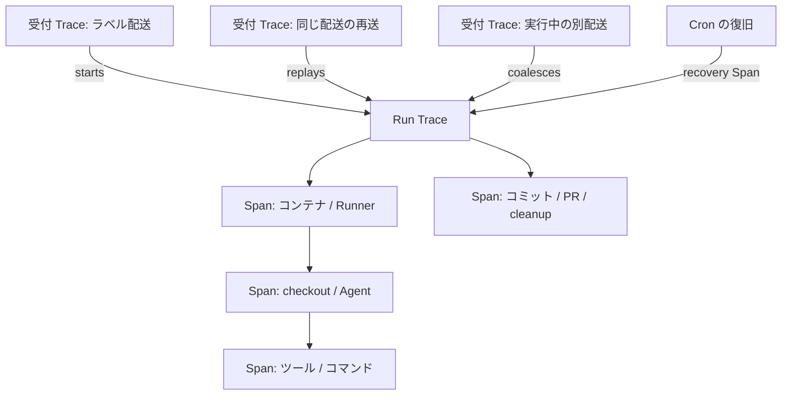

# Diagnostics

起動元から Agent の処理、成果物までを関連づけ、「何を受け取り、何が起動され、何を行い、どう終わったか」を調査する。

## 対象と共通モデル

対象は GitHub の起動判定 → Run → コンテナ・Runner → Agent・ツール・コマンド → コミット・PR 作成。ログインや接続管理全体の計測は今回の対象に含めない。

| 単位 | 意味 | 例 |
| --- | --- | --- |
| Trace | 一つの論理的な処理 | Webhook 受付1回、Run 1回 |
| Span | 親子関係を持つ処理区間 | コンテナ起動、checkout、Agent、コマンド、公開 |
| Event | ある時点で観測・確定した事実 | 起動判定、開始・終了、失敗、再試行、公開チェックポイント |
| Artifact | 診断の入出力本文 | 実効入力、コマンド出力、ツールの引数・結果、最終返答 |

各機能はイベントの意味を決め、共通レイヤーが相関 ID、スキーマ、本文検査、配送、保存、取得を扱う。業務の実行・復旧・成功判定は既存の RunStore と公開処理が担当する。

| 配置 | 責務 |
| --- | --- |
| `packages/core/src/diagnostics.ts` | プラットフォームに依存しない契約、上限、ID、Diagnostics interface |
| `packages/diagnostics` | Secretlint による本文検査。外に SDK の型を公開しない |
| `apps/api/src/application/diagnostics` | 調査用の port と取得モデル |
| `apps/api/src/infrastructure/diagnostics` | 必須履歴、D1/R2 保存・取得・清掃 |
| `apps/api/src/presentation/http/handlers/diagnostics` | operator 認証での検索・取得、Runner の専用 ingest |
| `apps/runner/src/diagnostics.ts` | 上限付きバッファ、本文検査、バッチ化、再送、flush |
| `apps/runner/src/codex-agent.ts` | プロバイダ固有の通知を共通記録へ変換 |

## 相関 ID

| ID | 単位と扱い |
| --- | --- |
| `requestId` | HTTP 受信ごとにサーバーが生成し、応答の `X-Request-ID` と記録に付ける。再送では別 ID |
| `traceId` | Webhook は `request/{requestId}`。Run は `run/{runId}` を維持し、DO の再起動でも変えない |
| `spanId` / `parentSpanId` | 処理区間とその親。外部操作の再試行には別 Span を使う |
| `runId` / `sessionId` | 既存の業務上の ID。診断用の ID と役割を分ける |
| `producerId` / `seq` | 割り当てられた Runner と、その発生元内の単調な順序 |
| `eventId` / `batchId` | 再送時も同じ ID と内容を使い、保存の重複を防ぐ |

署名検証前の入力や外部の tracing header を所有権の根拠にしない。TraceContext はジョブで明示的に Runner に渡す。本文に業務用の認証情報や診断リースを混ぜない。

起動対象外の受付 Trace は Run を持たない。同じ delivery ID の HTTP 再送は別の受付 Trace から元の Run にリンクする。既存の業務上の `disposition` は変更せず、診断上で replay と coalesce を区別する。

Span の親子関係は因果関係を表す。`occurredAt` と保存側の `receivedAt` を分け、異なるホストの時計で厳密な全体順序を保証しない。duration は同じ環境の単調時計から求める。

## 記録する経路

| 発生箇所 | 主な記録 |
| --- | --- |
| GitHub 受付 | 署名検証後の対象判定と理由、delivery ID、started/coalesced/replayed |
| RunStore | 受理、実行開始、成功・失敗と結果・失敗コード |
| DO | Runner への送信、コンテナ起動、状態取得の失敗と復旧、公開、cleanup |
| Cron | 対象 Run の再スケジュール |
| Runner | engine と締切、checkout の基準 SHA・ブランチ、差分の要約 |
| Agent | engine とバージョン、sandbox、報告された場合のモデル、補足指示を含む実効入力、最終返答 |
| ツール・コマンド | 実行内容、引数・結果、統合出力、終了コード、所要時間、変更パス・差分 |
| 公開 | 差分のチェックポイント、コミット、PR、照合結果 |

Agent の成功と Run の成功を分ける。外部へのリクエストがタイムアウトした場合は `unknown` を使い、相手側の未実行や失敗を断定しない。正常な状態ポーリングは毎回保存せず、失敗・復旧の変化を記録する。

Codex Adapter は対応する item の開始・完了と、Tailos の GitHub ツールを記録する。プロバイダが通知しない処理や内部の推論は記録できない。未知の raw RPC、認証 RPC、app-server の stderr 全文は保存しない。

## 保存先と保証

D1 が検索・経路・重要な事実を、非公開 R2 が本文を持つ。

| D1 テーブル | 主な役割 |
| --- | --- |
| `diagnostic_traces` | owner、Session/Run、起動元、delivery/request ID、保存状態、上限管理 |
| `diagnostic_links` | 受付から Run への starts/coalesces/replays |
| `diagnostic_events` | Span、発生元と順序、時刻、名称、検証済み属性、本文の Artifact ID |
| `diagnostic_artifacts` | R2 object の参照、digest、サイズ、期限、物理削除の状態 |

Event と Artifact の `ingest_seq` は AUTOINCREMENT とし、遅れて届いた記録もカーソルで取得できるようにする。Trace の一覧は作成時刻と ID の複合カーソルで、同時刻の記録を取りこぼさない。

### 必須の履歴

受付と Run・公開チェックポイントの重要な履歴は、条件付きの業務更新と同じ D1 batch で保存する。診断履歴の挿入に失敗すれば業務更新もロールバックし、既存の復旧経路で再試行する。

SQL トリガーは使わない。旧 Worker の更新件数や業務動作を変えず、移行中に旧 Worker が作った Run も次の処理で Trace と明示的な snapshot を補完できるようにする。履歴から業務を再生する Event Sourcing にはしない。

### 詳細な記録と本文

Runner は実行中から、検査済みの記録を1.5秒ごとに送信する。本文は完了したコマンド・ツールなどのまとまった単位で検査する。文字単位の delta を独立して保存しない。

1. API/DO が Run・producer に限定した専用の短命リースを割り当てる。
2. Runner が既知の秘密値と Secretlint で本文を検査してからバッチにする。
3. API は既存の Run と受付期限を確認してから、DO にリースの検証を委ねる。業務用の更新・公開リースとは分離する。
4. 保存側でも本文を検査し、不変の R2 object を保存する。
5. D1 の Artifact 参照と Event を同じ batch で保存してから ACK を返す。
6. ACK 消失時は同じ ID と内容で再送する。同一 ID の異なる内容や、他の Run/producer の記録は拒否する。
7. 終了時に最終 seq と省略件数を送る。終了直後の送信には2分の猶予を設け、Runner は D1/R2 の資格情報を持たない。

R2 key は `diagnostics/v1/{traceId}/{batchId}-{digest}.json`。同じ object を複数 producer で共有せず、Event の本文を読む際はバッチ内の eventId を参照する。公開用の差分チェックポイントは別の用途・寿命なので流用しない。

D1 と R2 の横断トランザクションは前提にしない。R2 成功・D1 失敗では ACK を返さず、再送と未参照 object の清掃で扱う。R2 の強整合性を利用して、本文保存後に D1 の参照を公開する。[D1 batch](https://developers.cloudflare.com/d1/worker-api/d1-database/#batch) · [R2 の整合性](https://developers.cloudflare.com/r2/reference/consistency/)

詳細な記録の保存失敗だけでは、Agent の成功や作成済みの PR を失敗へ変更しない。既存の `execution.json` の保存もこの方針に合わせ、業務結果・会話の永続化や公開チェックポイントとは切り分ける。詳細な診断の例外・本文を Workers Logs に再帰出力しない。

## Secretlint による本文検査

`@secretlint/core` と推奨ルール群を `13.1.0` に固定する。`lintSource()` が返す `messages[].range` を使って本文の該当範囲を伏せる。`maskSecrets: true` が伏せるのは検出メッセージであり、`sourceContent` 自体は未加工なので、そのまま保存しない。[core の実装](https://github.com/secretlint/secretlint/blob/v13.1.0/packages/%40secretlint/core/src/index.ts)

推奨ルールから `@secretlint/secretlint-rule-filter-comments` を明示的に除外する。本文内の `secretlint-disable`、対象リポジトリの設定や ignore によって検出を抑止させない。長時間動くプロセスでは profiler を無効にする。[推奨プリセット](https://github.com/secretlint/secretlint/blob/v13.1.0/packages/%40secretlint/secretlint-rule-preset-recommend/src/index.ts)

Secretlint で検出できない形式の資格情報には、既知の秘密値の完全一致による除去も併用する。Runner が受け取った access token、更新用・診断用の Bearer、checkout token とその Git 認証用表現、更新後の token を対象にする。認証 RPC、全ヘッダー、環境変数全体、RunnerJob の丸ごとの保存はしない。

本文検査で未知の秘密値をすべて検出できるとは限らない。非公開の Issue・ソース・出力として閲覧権限と保持期間を制限する。検査失敗や上限超過では、本文を未検査のまま保存する代替経路を設けない。

## 上限・欠落・期限

| 対象 | 初期値 |
| --- | --- |
| 一つの本文 | 128 KiB。JSON のエスケープで送信上限を超える場合も本文全体を省略 |
| HTTP バッチ | 512 KiB、最大32 Event |
| 未 ACK のバッファ | 4 MiB を目安に本文の展開も考慮して予約 |
| Run の保管量 | バッチ全体で32 MiB |
| Runner Event | 10,000件 |
| 本文の保持 | 30日 |
| 経路・Event の保持 | 90日 |

上限の目的は巨大な本文や高頻度の delta で業務 D1 と実行環境を圧迫しないこと。D1 のプラットフォーム上限とは別に、アプリ側で制限する。[D1 の制限](https://developers.cloudflare.com/d1/platform/limits/)

`captureState` は `collecting / complete / partial / unknown`。complete は、最終位置までの Event と終了マーカーがそろい、既知の省略がない場合にだけ付ける。Run 成功から推定しない。未完了 Span、本文の省略、検査失敗は partial、コンテナ消失で最終位置が不明なら unknown として扱う。

本文はコマンド完了時の統合出力として保存するため、長いコマンドの実行途中の文字列や、コンテナ消失直前の未完了の出力は保証しない。全通知を記録しているわけではなく、complete もプロバイダ内部の完全な監査を意味しない。より細かい出力の逐次保存は、境界をまたぐトークンと複数行の秘密鍵を安全に検査できる実装を追加してから行う。

Cron は期限切れの本文を50件ずつ、未参照 object も含む R2 prefix を100件ずつ巡回して削除する。削除に成功するまで D1 の参照を失わないようにし、本文の期限切れは物理削除前でも API が410で返す。Run の処理中は Trace を削除しない。R2 lifecycle は規模に応じた補助として利用できる。[R2 lifecycle](https://developers.cloudflare.com/r2/buckets/object-lifecycles/)

## 調査 API と画面

全経路で既存の operator 認証を使う。Run の所有者を確認し、Run に紐づかない受付は管理者である operator だけが調べられる。任意の R2 key を指定して取得する API は設けない。

| API | 用途 |
| --- | --- |
| `GET /api/diagnostics/traces?runId=...` | Run と関連する受付 Trace を取得 |
| `GET /api/diagnostics/traces?source=...&deliveryId=...` | 起動しなかった配送も検索 |
| `GET /api/diagnostics/traces/:id/events?after=...` | 受信順のカーソルで最大100件ずつ取得 |
| `GET /api/diagnostics/traces/:id/artifacts?after=...` | Artifact の一覧と期限を最大100件ずつ取得 |
| `GET /api/diagnostics/artifacts/:id` | 対象の上限付きバッチ本文を取得 |

Trace の一覧は最大50件で、`nextCursor` を次の `before` に渡す。Trace ID に含まれる `/` はパスパラメータとしてエンコードする。

Session の Run にある「実行記録を調べる」から `/diagnostics?runId=...` を開く。Run/配送 ID による検索、受付の選択、親 Span による階層表示、request ID、保存状態、本文の展開ができる。本文は要求されたときだけ取得し、期限切れ・取得失敗・保存範囲不明を区別する。

## 移行と検証

マイグレーション `0003` は4テーブル・インデックスと、既存 Run の snapshot を追加する。保存されていない中間処理や開始時刻を捏造しない。既存の `execution.json` と `events.ndjson` / `result.json` の取得は維持する。

RunnerJob の診断設定は optional とし、既存のジョブ・結果を受理する。新しいジョブは API と Runner を同じリリースで更新する。診断送信には非公開 R2 と HTTPS の `TAILOS_PUBLIC_ORIGIN` が必要。本文を送信できない構成でも業務処理と必須履歴は進み、保存範囲を complete と偽らない。

テストでは、同じ配送の再送、合流、重要な履歴の保存失敗による業務更新のロールバック、移行中の旧 Run、R2/D1 の片側失敗、ACK 消失、遅延 Event、リースの用途分離と期限、所有者を越えた取得、本文の上限・省略、抑止コメント、秘密鍵、更新後の資格情報、Workers 互換性を確認する。

検証コマンドは CI と同じ `pnpm format:check`、`pnpm lint`、`pnpm test`、`pnpm typecheck`、`pnpm --filter @tailos/web run build`。加えて Runner のバンドルと API の Wrangler dry run を確認する。
