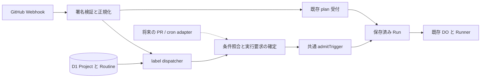

# トリガーと実行設定の抽象化、label 起動の移行計画

作成日: 2026-11-18。対象 checkout: `3607eff`。この文書は採択済みの実装計画。現在のブランチで実装と検証を進める。

## 目的と今回の範囲

「何を契機に動くか」と「どの依頼・実行設定で Run を作るか」を DB の設定で結び、イベント源から独立した共通の受付へ渡す。利用者は条件・prompt・model・effort を変更できるようにする。設定の単位を、この計画では **Routine** と呼ぶ。

最初に GitHub Issue の `issues.labeled` を移行する。設定の保存だけで終えず、設定 API・Web からの編集、保存値の Runner への反映、既存データの切替までを実装の到達点とする。実装・検証と PR のレビュー対応までを今回の作業に含める。

`@tailos plan` と回答コメントの inbox・Session 継続・Run 割当は現行経路に残す。PR トリガー、cron のスケジューラー、レビュー投稿、任意テンプレート言語、手動チャットの変更は後続とする。第一段階でも既存の label 起動の checkout・検証・PR 公開・Issue 通知は利用する。

## 判断の状態

| PDR | 状態とこの計画への適用 |
| --- | --- |
| [設定可能なトリガー](../pdr/records/PDR-20261118-configurable-triggers.md) | 採択済み。DB の条件と実行設定、共通境界、label から移行する方針 |
| [設定可能な label prompt](../pdr/records/PDR-20261118-configurable-label-prompt.md) | 採択済み。固定指示を設定へ移し、Issue の参照・ハッシュ・全文取得は維持 |
| [Routine の名称と初回移行](../pdr/records/PDR-20261118-routine-initial-migration.md) | 採択済み。Run のない状態を運用で作り、デプロイ専用の互換層は追加しない |
| [Routine ごとの Agent 選択](../pdr/records/PDR-20261118-routine-agent-selection.md) | 採択済み。Routine 単位の設定、今回は Codex、Claude は後続、model・effort 未指定時は provider 既定 |
| [label の照合・受付・管理](../pdr/records/PDR-20261118-label-routine-dispatch.md) | 採択済み。複数一致、重複排除、同時実行、競合、初期状態、移行・管理の規則 |
| [Project と Routine の設定分担](../pdr/records/PDR-20261118-project-routine-settings.md) | 採択済み。許可ユーザーは Routine、repository・通信許可・時間上限は Project。Project の label は削除を目標とする |
| [接続・モデル未検証時の保存](../pdr/records/PDR-20261118-routine-configuration-validation.md) | 採択済み。未検証でも無効状態で保存し、有効化時に検証する |

採択済みの判断には再承認を求めない。保存・有効化も採択済みであり、無効状態なら接続やモデル情報を確認できなくても保存する。PDR の採択は実装完了やデプロイを意味しない。

## 現状と再利用する境界

| 領域 | 確認した実装 | 計画への含意 |
| --- | --- | --- |
| イベント判定 | [github-event.ts](../../apps/api/src/application/triggers/github-event.ts) が label と計画コマンドを判定 | 署名検証後の正規化と、設定照合を分離する |
| Webhook | [github-webhook.ts](../../apps/api/src/presentation/http/handlers/github-webhook/github-webhook.ts) が Project の最初の一件を選び、条件検証・固定 prompt・Codex context を組み立てる | label 分岐を application の dispatcher へ委譲する。plan 分岐は残す |
| 共通受付 | [TriggerAdmission](../../apps/api/src/application/triggers/admit-trigger.ts) と [D1 の admitTrigger](../../apps/api/src/infrastructure/d1/trigger-admission.ts) | Session・automation メッセージ・Run・配送・通知の原子的保存を拡張して使う |
| 設定 | [Project スキーマ](../../apps/api/src/application/triggers/projects.ts) と [D1 Project store](../../apps/api/src/infrastructure/d1/projects.ts) に `triggerLabel` 等を保存 | Routine を Project から参照する。所有者の内部読出し契約も整える |
| 実行設定 | [共有契約](../../packages/core/src/runner.ts) の `ExecutionContext` / `RunnerJob` に model・effort の入力がない | DB 保存に加え、共有スキーマ・job 組立・Adapter まで値を通す必要がある |
| Agent 起動 | [codex-agent.ts](../../apps/runner/src/codex-agent.ts) は model 等を応答から観測するが、要求へ設定を渡していない | 固定された app-server の契約を確認し、対応する要求フィールドへ設定する |
| repository 実行 | [runner-container.ts](../../apps/api/src/infrastructure/cloudflare/runner-container.ts) の checkout・公開には Codex 限定分岐がある | Claude の Routine 対応は後続とし、今回の有効な選択肢には出さない |
| plan | [PlanningAdmission](../../apps/api/src/application/triggers/planning.ts)、[planning.ts](../../apps/api/src/infrastructure/d1/planning.ts) | 独自の delivery・inbox・受付順を維持する。Project の `triggerLabel` 読出しとの結合に注意する |

現行の `trigger_events` の一意キーは `(source, idempotency_key)`、label の同時実行キーは repository・Issue 中心であり、どちらも Routine の識別子を持たない。単に複数の設定をループして現在の受付に渡すと、別の Routine の依頼まで一つの Run にまとめられる。

また、[複数 Project への Webhook 配信](../pdr/records/PDR-20261116-project-webhook-fanout.md) は採択済みだが未実装で、repository の一意制約と最初の一件を選ぶコードが残る。[所有者割当の判断](../pdr/records/PDR-20261116-project-owner-assignment.md) は、複数配信まで単一運用者の起動を維持する範囲を定めている。この移行を理由に複数アカウント対応を完了扱いにしない。

## 構造案

以下は採択済みの設定・受付方針に基づく実装案である。未検証の設定は無効状態で保存できる。

### Routine と保存する値

| 保存先案 | 内容 |
| --- | --- |
| `routines` | `id`、`project_id`、名前、有効状態、trigger 種別と版付き条件、許可ユーザー、prompt、engine・model・effort、revision、作成更新の時刻と操作者、削除時刻 |
| `routine_changes` | 操作、操作者、時刻、変更前後。設定変更と同じトランザクションにする |
| `trigger_events` の拡張 | Routine ID、受理した設定 revision、外部 delivery ID。重複判定の識別子と生の delivery ID を区別する |
| Run の保存済み入力 | 開始メッセージに確定 prompt、`execution_context` に実行設定・接続 ID・Project と Routine の ID / revision・Issue context を保持する |

設定 JSON は `type` と `version` を持つ識別可能なスキーマとし、初版は `github.issue-label` と label 名だけを受け付ける。条件を実行する汎用コード、SQL、任意の式は保存しない。prompt を別の共有資源にする機能は必要になるまで作らない。

Routine の所有者は Project の所有者から導出する。入力の owner ID や connection ID を信頼せず、API が対応を確認する。API が読む内部 Project 契約には owner を含める必要がある。現在の `ProjectRecord` には owner が返らないため、そのままでは所有関係を検証できない。

repository・installation・通信許可・Run の時間上限は Project に、許可ユーザー `allowedActors` は Routine に置く。これは正式な分担とする。既存 label の許可ユーザーを Routine にコピーし、label の受付で Project の値へフォールバックしない。未移行の plan の許可ユーザー設定だけは従来の Project に残す。

旧 `Project.triggerLabel` は削除を目標とする。現在は plan の context 組立と D1 の Run 割当に参照があるが、GitHub の checkout は `mode === plan` では label を照合しない。plan の不要な参照と共有スキーマの必須制約を外せば、Project の項目を削除できる。label Run には一致した Routine の label を保存し、実行開始時のラベル再照合を維持する。削除不能な依存が実装中に判明した場合だけ、理由を残して一時保持する。

### application の契約

`NormalizedEvent → Routine の候補取得 → 権限と条件の検証 → 確定した実行要求 → AdmitTrigger` の流れにする。

- イベント adapter は外部イベントの検証・正規化を担当する。Issue タイトル・本文はハッシュ算出と初期タイトルに使い、ユーザーの prompt へ連結しない。
- matcher は trigger 条件を検証する。dispatcher は Project と Routine を解決し、実行要求を作る。HTTP の Request / Response や Cloudflare の scheduling を application に渡さない。
- 移行後の再送では、まず外部 delivery ID から既存の受付結果を照会する。その後に未受付の候補を照合することで、設定が無効化・削除・条件変更されても成功済み分は元の Run に対応付ける。移行前の旧キーを扱う互換 lookup は追加しない。
- 共通受付の要求には、発生源、配送の識別子、所有者、設定 ID / revision、作業対象、同時実行キー、prompt、execution context、timeout、診断の対応を含める。
- D1 store は既存配送の再送と新規受付を区別する。新規・coalescing の処理でも、Project と Routine の状態を確認してから副作用を保存する。revision guard を Session 作成だけに置いて終えない。
- 実行要求の確定後は、現在の設定を再読込せず保存済みの prompt と context を実行する。通知や公開も Run に固定した対象を使う。

共有するのは API と Runner の job・execution option の契約である。Routine の DB CRUD や GitHub 配送の照合まで `packages/core` へ持ち上げない。最初から plugin registry や汎用 workflow engine を設けない。

### 配送、競合、失敗

採用する識別単位は、冪等性が `(source, projectId, routineId, deliveryId)`、同時実行が `(ownerId, projectId, routineId, repositoryId, issueNumber)`。現在の複合値のエンコード方式を使えるが、診断用の delivery ID と混同しない。

同じ Routine の実行中に来た配送は coalescing し、別の Routine は独立させる。coalescing は待機キューではない。設定更新後の配送が旧 Run にまとめられても、その Run の prompt を更新しない。

Project の競合に対する [一回の再読込方針](../pdr/records/PDR-20261114-project-webhook-conflict.md) を Routine の競合にも適用する。再照合で無効化・削除・条件不一致になれば対象外とし、再競合は 503。既に受付済みの配送なら設定変更後も元の結果を返し、新規 Run の権限判定とは分ける。

一部の Routine だけ失敗した場合、成功分を巻き戻さず 503 と診断を残す。手動再送では未受付分を最新設定で照合し、成功済み分は再実行しない。この案では再送の間に追加された設定も候補になる。受信時の一致集合を固定する durable inbox は初版には設けない。

Run と受付・通知待ちの保存は原子的に行い、保存後の scheduling 失敗は既存 recovery に委ねる。設定破損時に固定 prompt に戻す経路は作らない。[通知の永続化](../pdr/records/PDR-20261113-006.md) と [削除後の既存 Run 続行](../pdr/records/PDR-20261114-project-deletion.md) は維持する。

### 設定 API と Web

API は Project 配下の一覧・作成・更新・無効化・削除・履歴を提供する案とする。URL 案は `/v1/projects/:projectId/routines`、更新には revision を要求する。具体的な method・レスポンス・件数制限は実装前に契約を確定する。既存の内部 smoke 用 `/triggers` はユーザー向け設定 API に転用しない。

既存の `/projects` 設定画面へ Routine 編集を組み込む。label、許可ユーザー、prompt、model、effort、有効状態、保存競合を扱い、未対応の PR / cron は選択肢に出さない。実装・公開を伴う現行 label 経路であること、複数一致時の実行増加を利用者が判断できるようにする。

FSD に従い、画面・form state・取得・mutation・query key / invalidation はまず `apps/web/src/_pages/projects/{ui,api,model}` にまとめる。ルートは既存公開 API の `index.ts` を経由し、App には接続だけを置く。他画面での再利用が生まれる前に Routine の Entities / Features を作らない。

## 実装の分割と完了条件

| 工程 | 主な変更 | 完了条件 |
| --- | --- | --- |
| 0. 契約の確定 | 保存・有効化、モデル能力の検証方法、複数結果 API | 保存・有効化を含めた PDR を採択済みとし、以下の契約で実装する |
| 1. DB と application の基盤 | Routine の型・schema・store、許可ユーザー移動、Project の label 削除、migration、設定履歴、確定要求の組立 | 初版以外の条件を拒否し、既存受付と plan はまだ切り替えない。migration と履歴が原子的・再実行可能である |
| 2. 実行オプションの伝達 | `ExecutionContext` / `RunnerJob`、DO の job 組立、Codex Adapter | 明示した model・effort が実際の provider 要求に届く。未指定と plan の挙動を保つ |
| 3. label dispatcher | handler の label 分岐、設定照合、共通受付の guard とキー、診断 | 固定 prompt を handler から除き、別 Routine の独立性・再送・競合・部分失敗を確認する |
| 4. ユーザー向け設定 | 所有者限定 CRUD、revision・Origin 検査、Project 作成 / import の整合、Web form と履歴 | Web から条件・prompt・model・effort を保存・有効化し、その内容で起動できる。別 owner の操作を拒否する |
| 5. 移行と切替 | Run のない状態で既存 label 設定を Routine へ移し、新経路を公開 | 既存 Project の設定と履歴を保持し、新規 label 起動と plan の継続入力を確認できる |

2 と 4 の一部は 1 の契約確定後に独立して進められる。実装を揃えてから、Run のない状態で migration と新経路の公開を行う。各工程で CI と対象の回帰ケースを通す。

## データ移行と公開手順

本番の利用者は運用者一人である。[初回移行の判断](../pdr/records/PDR-20261118-routine-initial-migration.md) に従い、queued / running の Run がない状態を運用者が作り、移行・公開中は起動操作や設定編集を控える。これを自動化する受付停止・drain・デプロイガードは作らない。

1. 既存 Project の label・許可ユーザーと固定 prompt を、一件の有効な Routine へ移す migration を適用する。移行済みの対応を識別し、再実行しても設定を重複作成・上書きしない。
2. Routine を利用する API・Runner・Web を公開する。旧 Worker の並行書込み、実行中 Run の引継ぎ、旧 concurrency key の変換、旧配送の再送互換性、旧版復帰のためだけの互換層は追加しない。
3. 新規 label 起動、移行後の配送の再送、設定変更、plan の継続入力を確認する。過去の Session・Run・履歴は保持し、既存の prompt・context を書き換えない。

plan の不要な label 参照を外し、`Project.triggerLabel` の削除を目指す。plan の許可ユーザー・会話の経路は維持する。複数利用者や無停止公開の要件が生じるまでは、新旧版を並行稼働させる公開方式を前提にしない。

## 検証

実装時は CI と同じ `pnpm format:check`、`pnpm lint`、`pnpm test`、`pnpm typecheck`、`pnpm --filter @tailos/web run build` を実行する。PDR の変更では `pnpm pdr check` を実行し、レビューで `pnpm pdr context --diff BASE...HEAD` を使う。

機能の境界を確認する回帰ケースは次のとおり。

- 正常な label だけが保存された prompt・model・effort で起動する。Adapter の provider 要求まで確認し、設定値の保存だけで成功としない。
- 署名不一致、異なる repository / installation、Routine の許可外 actor、closed Issue、PR、無効・削除済み設定は起動しない。Routine ごとに異なる許可ユーザーを判定し、Project の値を label の許可に使わない。条件を prompt で迂回できない。
- 同じ配送の同時受信・完了後の再送が一つの結果を返し、同じ対象の別 Routine は別 Run になる。coalescing した新配送の本文で旧 Run を上書きしない。
- Project / Routine の編集・無効化・削除と新規受付や coalescing が競合しても、古い権限で配送・通知だけを保存しない。設定競合の再試行回数と結果を確認する。
- 部分成功後の再送で成功分を再実行せず、設定破損や接続不在で別の prompt・モデル・owner に切り替わらない。保存直後の scheduling 失敗を recovery で回収できる。
- 設定の他人の Project ID / Routine ID による取得・編集・履歴照会を拒否する。Origin 検査、変更履歴の原子性、ログへの秘密情報の非露出を確認する。
- 既存 Project の設定移行とその再実行、過去の Session・Run・履歴の保持を確認する。Run の prompt・context を勝手に補完しない。新旧 Worker の混在や active Run の引継ぎは今回の検証対象にしない。
- Issue の内容ハッシュ・全ページ取得、4,000 UTF-16 単位と 32 KiB の境界を維持する。
- Project の label を省いた plan context が受理・実行できること、Routine の label を実装 checkout で照合することを確認する。plan の開始・回答・許可ユーザー・受付順・同一 Session・読み取り専用・通知・Project 削除後の扱いを回帰確認する。

## 確定した実装契約

Routine は一件ごとに条件と実行設定を持ち、複数一致は全件実行する。同じ Routine の実行中配送は既存 Run にまとめる。新規作成は無効、model・effort 未指定は provider の既定、今回は Codex と単一運用者に対応する。接続やモデル情報を検証できなくても無効状態なら保存できる。

- Routine API は `/v1/projects/:projectId/routines` の GET / POST、`/:id` の POST、`/:id/delete` の POST、`/history?before=...` の GET。設定更新と削除には現在の revision を指定する。
- 名前・label・許可ユーザーには既存の名前 100 文字・label 50 文字・許可ユーザー 1〜100 件の検証を再利用し、prompt は既存の 4,000 UTF-16 コード単位を維持する。model・effort は空文字や制御文字を拒否し、対応する値は接続した provider の能力情報で検証する。設定リクエストは既存 Runner ジョブと同じ 32 KiB の範囲で受け付ける。
- Routine 一覧は Project ごとの全件、履歴は既存 Project 履歴と同じ 50 件ずつのカーソル形式を利用する。今回新しい Routine 件数上限は導入しない。
- Webhook は `{results: [{routineId, sessionId, runId, disposition}], failed: [routineId]}` を返す。対象なし 204、全件受付済み 202、一部失敗 503 とし、失敗先を診断に残す。
- 能力情報は既存の CredentialBroker 内で所有者の接続を使って取得し、資格情報は公開しない。明示したモデルが存在しない・effort が未対応と分かる場合は拒否する。model 未指定で effort の対応を確定できない場合も、無効保存は許可し有効化は検証失敗とする。
- Runner は固定された Codex 0.166.0 の `model/list` で実際の選択に対する対応を確認し、`thread/start` / `turn/start` に model、`turn/start` に effort を渡す。明示値を別の値へ黙って変更しない。
- Routine 編集は Project 設定内の利用者の展開操作後に取得する。初期ページの必須データを増やさず、展開した領域だけに Loading・失敗表示を置く。

## 将来の追加点

Claude の Routine 対応は、Claude 自体の実行経路の対応後に追加する。接続の解決・ジョブ作成・checkout・実行・公開を通した動作と model・effort の反映を確認し、保存 API と UI の有効な選択肢を増やす。

PR ではイベント adapter と条件スキーマに加え、PR の head / base と信頼範囲、checkout、参照ツール、読み取り専用実行、レビュー投稿権限・結果の公開方法を設計する。現在の repository job は Issue と実装・公開を前提にするため、trigger 種別の追加だけではレビュー機能にならない。

cron では due な設定の列挙、タイムゾーン、予定時刻を使う冪等キー、遅延・欠落分の実行、重複と同時実行、実行者を別途決める。設定解決後の確定要求と Run 永続化は再利用する。外部 actor のいないイベントへ GitHub の `allowedActors` を無条件に流用しない。

plan の移行では、新規 Run を作る処理だけでなく、Session の継続と inbox の入力割当を別の実行方式として設計する。今回の抽象化に合わせて会話を単発 Run に置き換えない。
